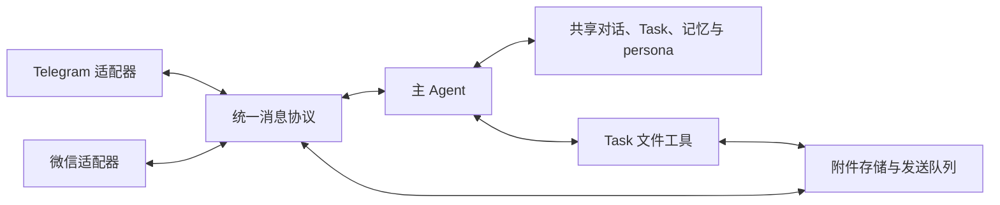

# 多渠道消息与附件设计

状态：2026-11-04 设计访谈已收敛，等待整体理解确认；以下为拟议实现，不表示当前程序已经支持。产品取舍见 [V2-TRADEOFFS.md](V2-TRADEOFFS.md#微信渠道设计访谈2026-11-04尚未实现)，术语见 [CONTEXT.md](../CONTEXT.md)。

## 1. 目标与范围

同一个使用者可以通过 Telegram 或微信与同一个个人 Agent 交互。每个实例同时只启用一个渠道；切换后继续原有对话、Task、长期记忆和 persona，未发出的结果交给当前渠道。

两个渠道都支持文字和普通文件消息。单文件接收、发送的本地上限均为 20 MB（20,000,000 字节）。图片以普通文件方式发送时按原文件处理；本次不接入原生相册图片、语音、视频、群聊或多使用者。

附件下载、保存和发送属于本次范围。文件读取、解析和生成继续交给 Agent 工具；本次不增加 PDF、Office 或压缩包解析器。现有 Task 工作目录提供的 UTF-8 文本工具有自己的 1 MiB 限制，不能把 20 MB 传输上限解释为所有文件都能被现有工具处理。

## 2. 结构与职责



图中的两个适配器可选，启动时只运行其中一个。统一协议以进程内的共享消息类型实现，沿用现有 `personal.Runtime`、Store 和 Task 调用链。

| 边界 | 职责 |
| --- | --- |
| 渠道适配器 | 登录、核对发送者、接收消息、下载上传文件、调用平台发送接口、解释平台错误 |
| 统一消息契约 | 表达正文、附件、来源和引用关系；隔离平台消息格式 |
| personal Store | 保存事件、统一历史、渠道进度、附件元数据和投递状态，处理去重与恢复 |
| 主 Agent | 理解使用者请求、关联 Task、选择交付文件、管理长期记忆 |
| Task 文件工具 | 在现有工作目录边界内处理材料、产生和修改文件 |
| CLI | 微信绑定与换绑、渠道状态查询、附件列表与删除 |

同一数据库仍服务于同一个 Owner。平台用户 ID 作为渠道绑定保存，不再直接代表核心 Owner；渠道切换不创建另一套记忆。V1 阅读归档和其 CLI 继续使用原有数据语义。

## 3. 统一消息契约

下表定义必要语义，具体 Go 类型复用并扩展现有 `Input`、`Event`、`TaskInput`、`TurnOutput`、`Outgoing` 和公共内容类型。

| 内容 | 必须保留的语义 |
| --- | --- |
| 身份 | 消息已通过当前绑定账号的校验，归属于本实例的 Owner |
| 来源 | 渠道、Bot 账号、会话和平台消息 ID，用于去重、引用和追溯 |
| 正文与附件 | 正文可以为空；只有文件的消息也是有效输入。一条消息的正文和附件保留关联 |
| 引用关系 | 保留平台提供的被引用消息信息；能映射到本地事件或 Task 时使用该关联 |
| 附件描述 | 本地附件 ID、显示文件名、媒体类型、字节数、可用或失败状态；文件内容通过受控引用读取 |
| 材料性质 | 延续直接用户输入与转发材料的区别，附件正文不会自动成为新的任务授权或个人事实 |
| 输出 | 允许纯文字、纯文件或二者组合；主 Agent 明确选择要交付的文件 |

本地 Event、Task 和 Run 编号继续使用现有类型。平台标识按不透明值处理，不要求微信用户 ID、接收游标或发送回执可以转换为正整数。

接收进度按渠道和 Bot 账号分别保存。Telegram offset 与微信游标的具体推进方式由适配器负责；不能用单个全局整数游标表示两者。消息去重至少区分渠道、Bot 账号、会话和消息 ID，不让不同渠道的同号消息相互覆盖。

登录凭证、媒体解密密钥和微信会话令牌由渠道代码管理，不进入模型输入。模型得到正文、附件信息和必要的来源或引用关系。

分开发送的文字与文件按接收顺序保存，保留各自边界。主 Agent 根据引用和上下文关联任务，有歧义时询问；适配器不设置时间窗口来猜测并拼接消息。新消息不会仅因包含文件就自动获得一个新任务目标。

## 4. 微信登录与服务运行

以下命令和配置均为拟议接口，尚未实现。

```sh
kagari -config config.yaml weixin login
kagari -config config.yaml weixin rebind
kagari -config config.yaml channel status
kagari -config config.yaml run
```

```yaml
personal:
  channel: weixin
```

新增渠道配置默认保留 Telegram，使现有配置仍能启动原渠道。微信凭证由登录流程保存，不要求使用者把 token 手动写入 YAML。

### 绑定与重新授权

1. `login` 请求二维码，在终端展示二维码和备用链接，并支持保存二维码图片。本地终端和 SSH 使用同一流程。
2. 轮询扫码状态，处理手机确认、验证码、过期、取消和服务端要求的登录地址切换。网络失败与二维码过期分别显示实际状态。
3. 核对服务端返回的 Bot 和用户身份。首次绑定建立该渠道与现有 Owner 的关系；同一账号允许更新凭证。
4. 若已有绑定而扫码用户不同，普通 `login` 不覆盖绑定或有效凭证。使用者需明确执行 `rebind` 完成账号替换；旧消息的来源记录仍保留。
5. 凭证以仅当前系统用户可读写的权限保存，更新采用原子替换。二维码及凭证只出现在需要它们的交互或存储位置，不写入常规文件日志。

登录命令只验证登录和本地存储所需配置，不调用模型。登录状态、绑定状态和消息是否成功投递分别记录，不把“已有凭证”展示为“消息已送达”。

### 运行与恢复

`run` 启动当前渠道收件、主对话、Task、记忆维护和投递。微信使用主动长轮询，二维码登录和收件均不需要公网回调地址。

明确的登录失效只暂停该渠道收发；已接收任务继续按原预算执行，结果保存到本地。服务状态和日志给出重新登录操作。同一账号在另一终端完成 `login` 后，运行中的适配器重载凭证并恢复连接，主 Agent 和 Task 不因此重启。

登录恢复不等于旧会话必然允许发送。若平台需要新的会话上下文，保留待发送结果并提示使用者向 Bot 发起新消息，取得可用上下文后再尝试发送。

切换 Telegram 与微信需要停止服务、修改渠道配置并用同一数据库及文件目录重启。沿用现有阶段恢复和预算规则，执行中的阶段可能重做；此处不实现运行中切换渠道。

## 5. 文件从输入到交付

### 接收

渠道下载原始文件并保存到受控附件目录，使用本地附件 ID 管理文件。显示文件名仅作为元数据，不作为任意本地写入路径。文件完成保存后，事件才可把它标为可用；接收记录、附件引用与渠道进度需要协调提交，避免重启后出现“已消费但没有文件”的输入。

接收前检查声明大小，接收过程中仍限制实际字节数。超限、下载或解密失败必须留下明确状态，不能把截断文件当作完整附件，也不能把只有文件的消息静默过滤。暂存文件不作为可用附件交给 Agent。

### 交给 Agent 与 Task

主 Agent 同时看到用户正文与结构化附件描述。文件信息独立于有长度限制的摘要传递，不能只靠模型从截断的文本里找路径。

建立或更新 Task 时传递选定附件引用。复用现有 Task 工作目录和文件工具，将需要处理的材料提供给对应 Task；工作副本与收到的原文件区分，后续修改不改变已收到的原件。读取能力由现有工具决定，不支持的格式应说明限制。

### 交付

Task 的 `StageResult.Files` 是候选成果信息。主 Agent 按任务要求选择入站附件或受控 Task 文件作为交付物；程序验证引用和路径，生成固定内容的附件，再把正文及附件加入发送队列。

排队后 Task 再次修改同一路径，不能改变已经排队的文件内容。微信按普通文件消息发送，Telegram 按 document 发送；不因文件扩展名自动切换为本次未支持的原生媒体类型。

发送队列记录每段文字或每个文件的投递进度。某个文件失败不会导致已经成功发送的文字或其他文件重复发送。

### 保留与删除

```sh
kagari -config config.yaml attachments list
kagari -config config.yaml attachments delete ATTACHMENT_ID
```

附件保留至明确删除。列表提供附件 ID、名称、大小、来源和状态，支持按 ID 执行删除。删除只移除指定附件保存的原文件并记录删除状态；已有分析、Task 工作副本、记忆和远端已收到的文件仍保留。

已删除附件的新读取或投递应明确报告文件不可用，不能悄悄重新下载来撤销删除。删除发生前已读取的内容不会被追回。命令只在元数据与文件状态一致后报告成功；失败应给出实际状态。

## 6. 投递与失败语义

| 情况 | 行为 |
| --- | --- |
| 尚未发送的结果 | 交给当前启用的渠道，按该渠道限制处理文字和文件 |
| 已确认成功 | 保留接收证据，不因重启或切换渠道重发 |
| 发送结果不确定 | 保持 `uncertain`，不自动重发或转投 |
| 可确认未送达的普通临时失败 | 延续每个投递项最多三次尝试，包含首次；新投递项从零计数 |
| 等待登录或会话恢复 | 保留结果；等待本身不增加尝试次数，恢复授权不重置已有发送尝试计数 |
| 超限、不支持或文件已删除 | 明确记录原因，不无限重试 |
| 平台成功但没有数字消息 ID | 按已验证的业务成功响应记录投递事实，不再以正整数回执作为唯一成功条件 |

平台错误、登录失效和文件失败不能直接取消所有 personal workers。数据库等导致本地状态无法可靠保存的错误，继续使用现有服务失败与恢复边界。

来源渠道用于追溯，投递目标用于当前发送，两者分开记录。切换时只处理确定未发出的内容；已经发出或结果不确定的部分保留原渠道和账号证据。

## 7. 数据兼容与改动范围

支持将本次变更前的现有 V2 数据库增量升级到新结构。保留本地事件、任务、执行和记忆编号，保留记忆的来源事件、版本历史与遗忘标记；不重新提取、复制或清空个人记忆。

原 Telegram owner 记录转换为渠道绑定，原游标归入 Telegram 账号的接收状态，既有消息和回执补齐来源。旧文本投递继续可发送，`sent` 与 `uncertain` 状态不被重置。升级应可以重复检查，事务失败时保留原库；未识别的更早结构应明确报告不兼容。V1 数据不纳入本次迁移。

附件二进制与渠道凭证分别放在数据库旁的受控目录，沿用已有 `store_id` 区分实例文件。迁移不更换现有工作目录所依赖的 store 身份。备份或迁移实例时，应一起保留数据库、附件、Task 工作目录和凭证。

| 模块 | 必要改动 |
| --- | --- |
| `cmd/kagari`、`internal/config` | 增加登录、换绑、状态和附件命令；按渠道验证配置并组装运行时 |
| `internal/personal` | 扩展输入、输出、Task 附件引用、历史、Store 与投递契约；解除 Telegram 身份和回执假设 |
| `internal/domain` | 复用公共内容类型，增加必要的文件描述与引用，核对 V1 调用方兼容性 |
| `internal/telegram` | 接入统一契约，保留原文字行为，补 document 下载与发送 |
| `internal/weixin` | 新增登录、API 客户端、普通文件传输和错误分类，按职责分文件 |
| `internal/workspace` 与 Task 执行器 | 复用当前文件边界，衔接选定入站材料和出站成果；不扩展到任意本地路径 |
| 日志与文档 | 增加渠道及附件元数据、等待授权原因和投递证据，屏蔽新增凭证；更新使用说明与配置示例 |

工作区已有 Task 文件能力的独立改动。实施前应核对最终合入状态，复用已存在接口，避免同时重写相同职责。

## 8. 可独立验证的迭代

| 迭代 | 交付内容 | 验证重点 |
| --- | --- | --- |
| 1. 统一身份与消息 | 渠道绑定、共享消息契约、V2 增量升级，Telegram 原文字流程继续工作 | 旧库数据保留、跨渠道 ID 不冲突、旧文字收发回归 |
| 2. 附件与 Telegram 闭环 | 本地附件、Task 引用、成果选择和固定内容投递、附件 CLI、Telegram 文件收发 | 真实文件字节往返、纯文件事件、正文与文件组合、删除及排队后修改 |
| 3. 微信登录与文字 | CLI 二维码、身份绑定、长轮询、文字投递及凭证重载 | 状态轮询、重复消息、账号不匹配、任务运行期间重新授权 |
| 4. 微信文件与恢复 | 普通文件上传下载、渠道切换、会话等待和实机联调 | 文件一致性、失败状态、重启恢复、待发结果改走当前渠道 |

每个迭代由主 Agent 负责契约和集成，将边界明确的编码任务交给适用的 Luna 子 Agent，避免多个 Agent 修改同一文件。以上是后续实施安排，本次访谈不执行运行代码改造。

## 9. 验收标准

| 场景 | 应观察到的结果 |
| --- | --- |
| 从 Telegram 切到微信 | 原对话、Task 和个人记忆可继续查询；无需复制记忆或建立新库 |
| 两渠道消息 ID 相同 | 保存为不同输入，引用与 Task 关联不串线 |
| 收件重放或重启 | 同一平台消息只形成一个本地输入，游标推进与持久化保持一致 |
| 单独发文件、发带说明文件 | 附件与原始消息关系正确，文件单独到达不会被过滤 |
| 不支持的原生媒体 | 明确说明首版需要普通文件消息，不能把收到媒体当作已完成处理 |
| 文件大小边界 | 本地恰好 20,000,000 字节通过检查，超出一个字节被拒绝；实际下载超限也能停止 |
| 入站失败 | 下载、解密、空间不足或文件保存失败有可查状态，Agent 不获得假成功附件 |
| 文件交付 | 两渠道收到的文件与选定原件字节一致；中间文件不会自动发送 |
| 交付后修改工作文件 | 已排队成果仍发送入队时的内容 |
| 文件删除 | 原文件移除、引用显示已删除，历史分析和记忆仍可查；后续读取失败明确 |
| 登录失效与恢复 | 已接收 Task 继续执行，结果保留；同一账号重新授权不停止任务 |
| 扫码换了账号 | 普通登录不会覆盖已有绑定；显式换绑后才能使用新账号 |
| 部分投递成功后失败或重启 | 成功部分不重发，不确定部分不自动重试，确定未发出的部分可继续 |
| 升级当前 V2 库 | Task、Run、事件、记忆及其来源、工作目录身份和既有投递状态保留 |

工程验证先使用临时 SQLite、受控文件、模拟平台 API 和可控执行器，覆盖边界与恢复，再运行受影响测试、构建和仓库要求的检查。文档检查通过不等于上述验收通过。

真实 Telegram 和微信联调分别验证扫码、文字、普通文件往返、重新授权与长任务回复；实际执行扫码由使用者在自己的微信端完成。模拟测试不能证明平台当前账号权限或会话规则。

## 10. 已知平台边界

Telegram 托管 API 的下载上限为 20 MB，document 上传上限为 50 MB；本设计主动将本地双向上限统一为 20 MB。[getFile](https://core.telegram.org/bots/api#getfile)、[sendDocument](https://core.telegram.org/bots/api#senddocument)

腾讯的公开协议没有明确普通文件的平台大小上限，也没有承诺 `context_token` 的有效期或重新扫码后的旧会话可用性。20 MB 是 Kagari 的本地限制，微信实际接受范围与会话恢复需要实测；发送受限时保留结果并说明原因。[微信后端协议](https://github.com/Tencent/openclaw-weixin/blob/main/docs/protocol_zh_CN.md)
